# Asignación 2 – Implementación de RADIUS, AAA y SSH

**Institución:** Instituto Tecnológico de las Américas (ITLA)  
**Carrera:** Seguridad Informática  
**Estudiante:** Merolyn Mejía Abreu  
**Matrícula:** 2025-0827  

---

## 🎥 Video demostrativo

**[Ver video demostrativo del laboratorio](https://youtu.be/Q0eV1bktjco)**

> Haz clic, el video demuestra el funcionamiento de la infraestructura, las conexiones SSH, la autenticación RADIUS y los niveles de privilegio.

---

## 📑 Índice

1. [Propósito del laboratorio](#1-propósito-del-laboratorio)
2. [Herramientas utilizadas](#2-herramientas-utilizadas)
3. [Topología de red](#3-topología-de-red)
4. [Plan de direccionamiento IP](#4-plan-de-direccionamiento-ip)
5. [Configuración del router R1-RADIUS](#5-configuración-del-router-r1-radius)
6. [Configuración del switch SW1-RADIUS](#6-configuración-del-switch-sw1-radius)
7. [Configuración de Windows Server 2022](#7-configuración-de-windows-server-2022)
8. [Pruebas de autenticación y privilegios](#8-pruebas-de-autenticación-y-privilegios)
9. [Registros de NPS](#9-registros-de-nps)
10. [Medidas de seguridad implementadas](#10-medidas-de-seguridad-implementadas)
11. [Scripts y comandos utilizados](#11-scripts-y-comandos-utilizados)
12. [Running-Configs](#12-running-configs)
13. [Resultados del laboratorio](#13-resultados-del-laboratorio)
14. [Conclusión](#14-conclusión)

---

## 1. Propósito del laboratorio

El propósito de este laboratorio fue implementar una infraestructura de red con autenticación centralizada mediante RADIUS, utilizando un router Cisco, un switch Cisco y Windows Server 2022.

El objetivo principal fue controlar quién puede acceder a los dispositivos y qué permisos recibe cada usuario después de iniciar sesión.

Para conseguirlo, configuramos AAA, que permite realizar tres funciones:

- **Autenticación:** comprobar la identidad de los usuarios.
- **Autorización:** determinar los permisos de cada usuario.
- **Accounting:** registrar las sesiones de acceso.

También habilite SSH para administrar los dispositivos de forma remota mediante conexiones cifradas y utilizamos Active Directory para organizar los usuarios según sus niveles de privilegio.

Esta práctica me permitió comprender cómo una empresa puede administrar los accesos a sus dispositivos de red desde un servidor central.

---

## 2. Herramientas utilizadas

| Herramienta | Función |
|---|---|
| GNS3 | Creación y conexión de la topología |
| Cisco 7200 | Router utilizado en el laboratorio |
| Cisco IOSvL2 | Switch utilizado en el laboratorio |
| Windows Server 2022 | Servidor de autenticación |
| Active Directory | Administración de usuarios y grupos |
| Network Policy Server (NPS) | Servidor RADIUS |
| VMware Workstation | Virtualización de Windows Server |
| PowerShell | Pruebas de conexión SSH |
| Visor de eventos | Revisión de registros de autenticación |

---

## 3. Topología de red

La infraestructura está formada por un router conectado a un switch y un servidor Windows Server 2022 conectado al mismo switch.

El router y el switch funcionan como clientes RADIUS, mientras que Windows Server se encarga de procesar las solicitudes de autenticación mediante NPS.

### Evidencia 0 – Diagrama / Topología

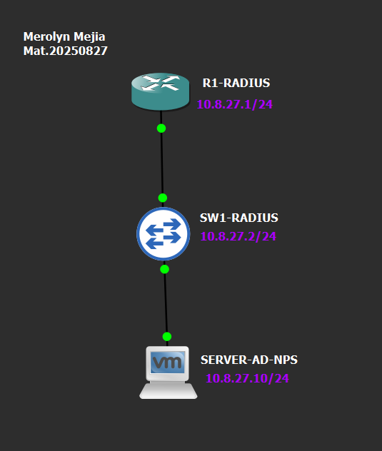

En esta imagen se muestra la conexión entre los tres dispositivos y las direcciones IP utilizadas.

---

## 4. Plan de direccionamiento IP

Utilizamos la red `10.8.27.0/24` para comunicar los dispositivos del laboratorio.

| Dispositivo | Interfaz | Dirección IP | Máscara |
|---|---|---|---|
| R1-RADIUS | FastEthernet0/0 | 10.8.27.1 | 255.255.255.0 |
| SW1-RADIUS | VLAN 1 | 10.8.27.2 | 255.255.255.0 |
| Windows Server 2022 | Ethernet0 2 | 10.8.27.10 | 255.255.255.0 |

La dirección `10.8.27.10` corresponde al servidor NPS, encargado de atender las solicitudes RADIUS del router y del switch.

---

## 5. Configuración del router R1-RADIUS

En el router configuramos la dirección IP, autenticación AAA, servidor RADIUS, acceso SSH y registros de inicio de sesión.

### Evidencia 1 – Configuración IP del router

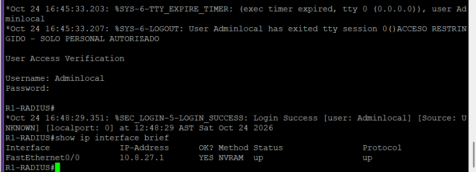

Configuramos la interfaz FastEthernet0/0 con la dirección IP `10.8.27.1/24`.

Después verificamos su estado mediante el comando:

`show ip interface brief`

Esto permitió comprobar que la interfaz estaba activa y tenía la dirección IP correspondiente.

### Evidencia 2 – Configuración de AAA y RADIUS

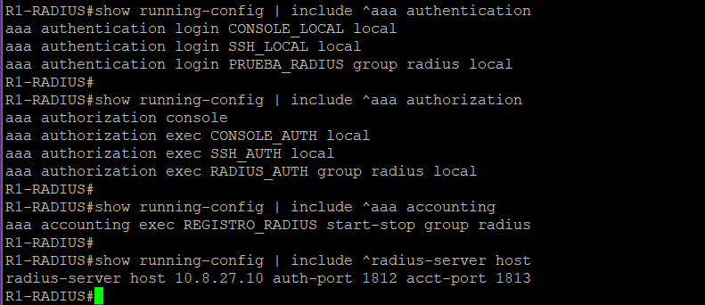

Habilitamos AAA para controlar los accesos al router.

Configuramos autenticación local para la consola y el puerto auxiliar, mientras que las conexiones remotas utilizan RADIUS con respaldo local.

También configuramos autorización de sesiones y Accounting para registrar los inicios y cierres de sesión.

El servidor NPS tiene la dirección IP `10.8.27.10` y utiliza los puertos UDP 1812 y 1813.

### Evidencia 3 – Configuración de SSH

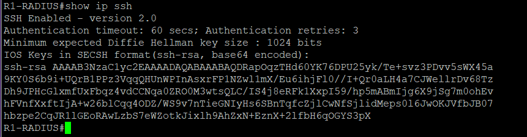

Habilitamos SSH versión 2 para permitir la administración remota del router mediante conexiones cifradas.

Utilizamos `show ip ssh` para comprobar que el servicio estuviera habilitado.

### Evidencia 4 – Configuración de consola, auxiliar y VTY

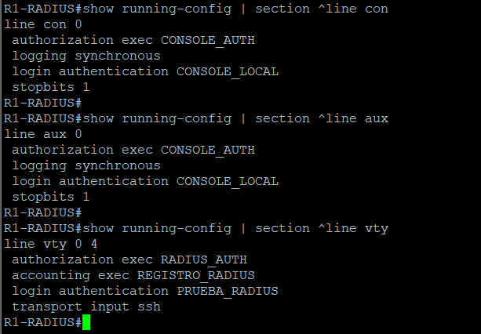

Configuramos las líneas de acceso del router de la siguiente manera:

- Consola: autenticación y autorización local.
- Auxiliar: autenticación y autorización local.
- VTY: autenticación y autorización mediante RADIUS.
- Acceso remoto: únicamente SSH.

También habilitamos Accounting en las líneas VTY.

### Evidencia 5 – Estado y estadísticas de RADIUS

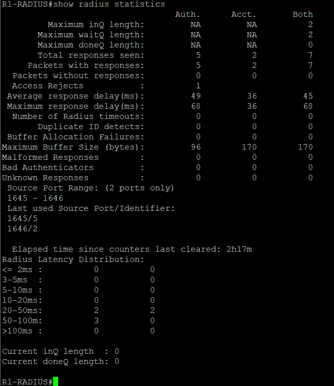

Ejecutamos el comando `show radius statistics` para comprobar las solicitudes y respuestas de RADIUS.

Los resultados mostraron intercambio de mensajes de autenticación y Accounting entre el router y el servidor NPS.

### Evidencia 6 – Registros de inicio de sesión

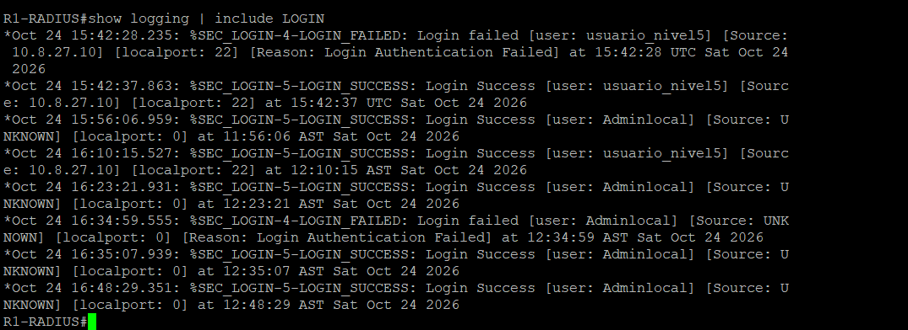

Configuramos el router para registrar los intentos de acceso exitosos y fallidos.

Utilizamos el comando:

`show logging | include LOGIN`

De esta forma comprobamos que se estaban generando registros de inicio de sesión.

---

## 6. Configuración del switch SW1-RADIUS

En el switch configuramos AAA, RADIUS, SSH, Accounting y medidas adicionales de seguridad.

### Evidencia 7 – Configuración IP del switch

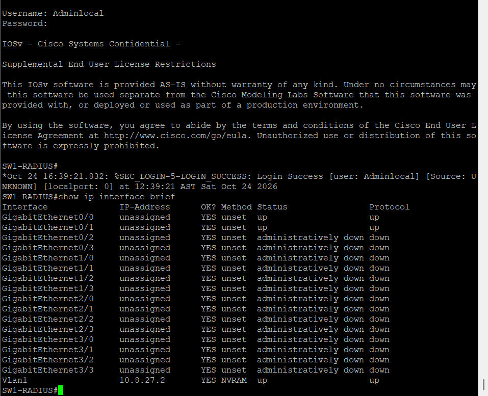

Configuramos la interfaz VLAN 1 con la dirección `10.8.27.2/24` y establecimos `10.8.27.1` como puerta de enlace.

Verificamos la configuración mediante `show ip interface brief`.

### Evidencia 8 – Configuración de AAA y RADIUS

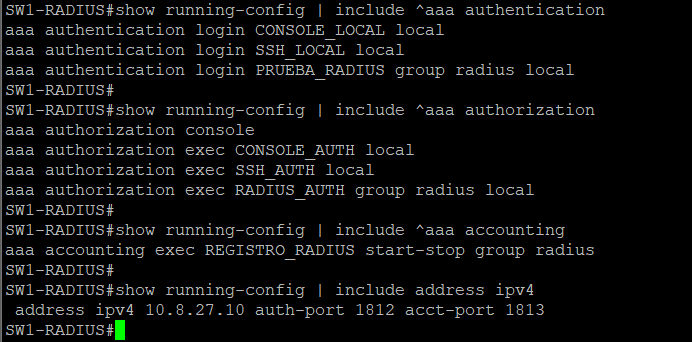

Habilitamos AAA para administrar la autenticación y autorización de los usuarios.

Configuramos el servidor RADIUS con la dirección `10.8.27.10` y habilitamos Accounting para registrar las sesiones.

### Evidencia 9 – Configuración y funcionamiento de SSH

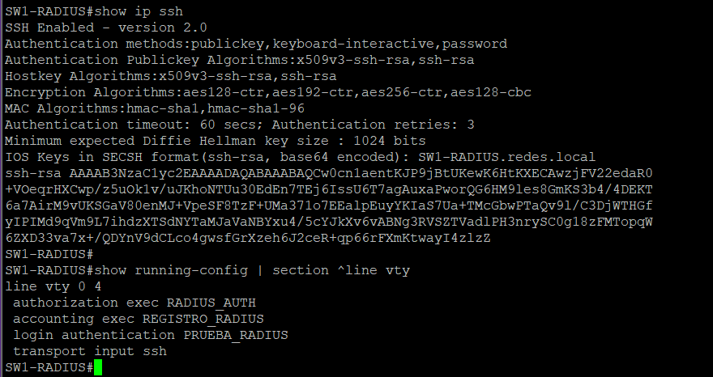

Habilitamos SSH versión 2 y configuramos las líneas VTY para permitir únicamente conexiones SSH.

Las conexiones remotas utilizan autenticación mediante RADIUS.

### Evidencia 10 – Estado del servidor RADIUS

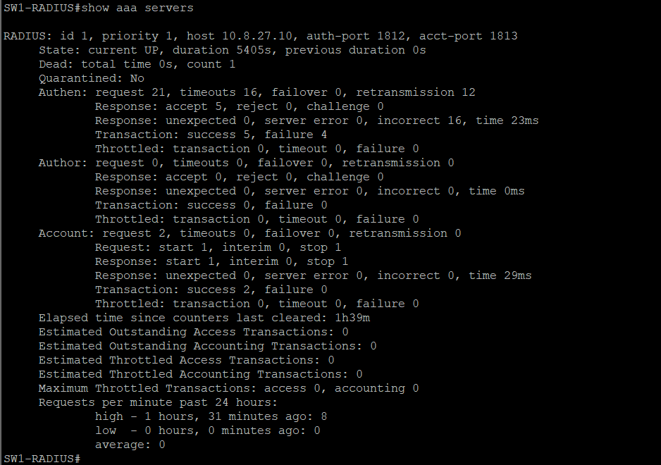

Ejecutamos `show aaa servers` para verificar el estado del servidor NPS.

El resultado mostró el servidor disponible y estadísticas de autenticación y Accounting.

### Evidencia 11 – Puertos activos y deshabilitados

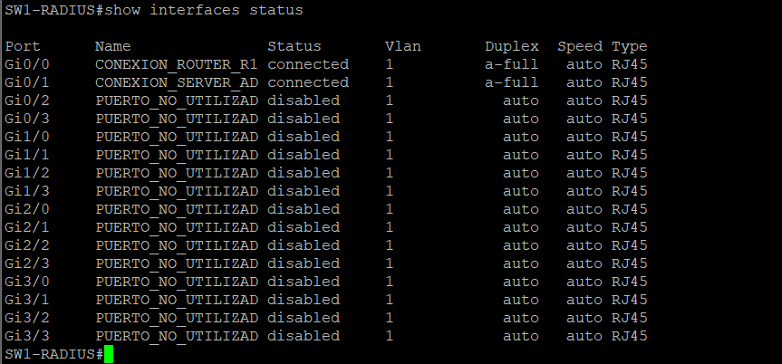

Deshabilitamos los puertos que no estaban siendo utilizados.

Los únicos puertos que permanecieron activos fueron:

- Gi0/0: conexión con el router.
- Gi0/1: conexión con Windows Server.

Los otros 14 puertos fueron deshabilitados mediante `shutdown`.

Esta medida ayuda a reducir las conexiones no autorizadas.

### Evidencia 12 – Registros de autenticación

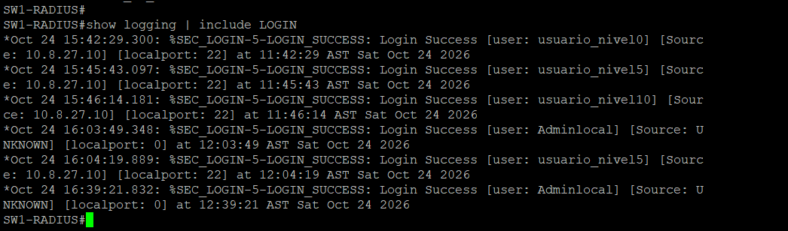

Configuramos el switch para guardar registros de los intentos de inicio de sesión.

Utilizamos `show logging | include LOGIN` para comprobar los mensajes registrados.

### Evidencia 13 – Configuración de consola, auxiliar y VTY

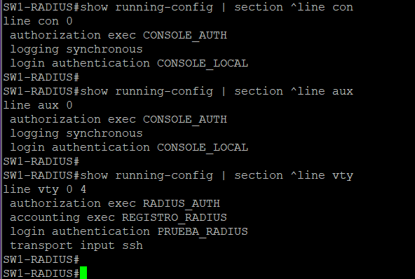

Configuramos autenticación local para los puertos de consola y auxiliar.

Las líneas VTY utilizan autenticación y autorización RADIUS, permiten únicamente SSH y tienen Accounting habilitado.

---

## 7. Configuración de Windows Server 2022

Utilizamos Windows Server 2022 como servidor central de autenticación.

Configuramos Active Directory Domain Services y Network Policy Server para administrar los usuarios y sus niveles de privilegio.

### Evidencia 14 – Configuración IP de Windows Server 2022

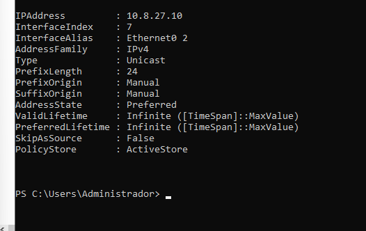

Configuramos la dirección `10.8.27.10/24` en el adaptador de red del laboratorio.

Esta dirección permite que el router y el switch se comuniquen con NPS.

### Evidencia 15 – Usuarios y grupos de Active Directory

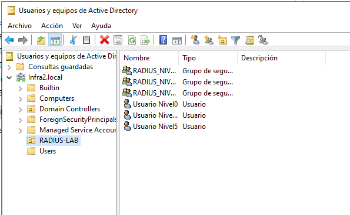

Configuramos el dominio `infra2.local` y creamos la unidad organizativa `RADIUS-LAB`.

Dentro de ella creamos tres grupos:

- `RADIUS_NIVEL_0`
- `RADIUS_NIVEL_5`
- `RADIUS_NIVEL_10`

También creamos los usuarios:

- `usuario_nivel0`
- `usuario_nivel5`
- `usuario_nivel10`

Cada usuario pertenece al grupo correspondiente a su nivel de privilegio.

### Evidencia 16 – Clientes RADIUS registrados en NPS

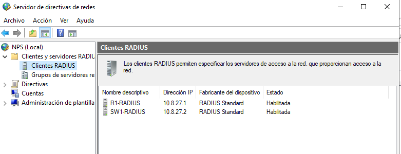

Registramos los dos dispositivos Cisco como clientes RADIUS en NPS.

| Cliente RADIUS | Dirección IP |
|---|---|
| R1-RADIUS | 10.8.27.1 |
| SW1-RADIUS | 10.8.27.2 |

Cada dispositivo utiliza una clave compartida para comunicarse con el servidor.

Las claves no se publican por seguridad.

### Evidencia 17 – Políticas RADIUS y niveles de privilegio

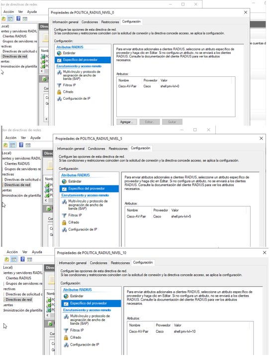

Creamos tres políticas de red para asignar distintos niveles de privilegio.

| Política | Grupo | Atributo Cisco |
|---|---|---|
| POLITICA_RADIUS_NIVEL_0 | RADIUS_NIVEL_0 | `shell:priv-lvl=0` |
| POLITICA_RADIUS_NIVEL_5 | RADIUS_NIVEL_5 | `shell:priv-lvl=5` |
| POLITICA_RADIUS_NIVEL_10 | RADIUS_NIVEL_10 | `shell:priv-lvl=10` |

Utilizamos el atributo `Cisco-AV-Pair` para enviar el nivel de privilegio correspondiente a cada usuario.

### Evidencia 18 – Registros de autenticación en NPS

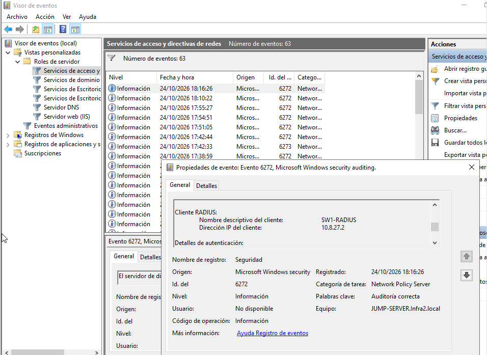

Revisamos el Visor de eventos de Windows Server para comprobar las autenticaciones.

Encontramos eventos 6272 que indican solicitudes de acceso permitidas por NPS.

---

## 8. Pruebas de autenticación y privilegios

Realizamos conexiones SSH desde Windows Server hacia el router y el switch.

El objetivo fue comprobar que los usuarios de Active Directory pudieran autenticarse mediante RADIUS y recibir sus niveles de acceso.

### Evidencia 19 – Pruebas SSH de niveles 0, 5 y 10 en el router

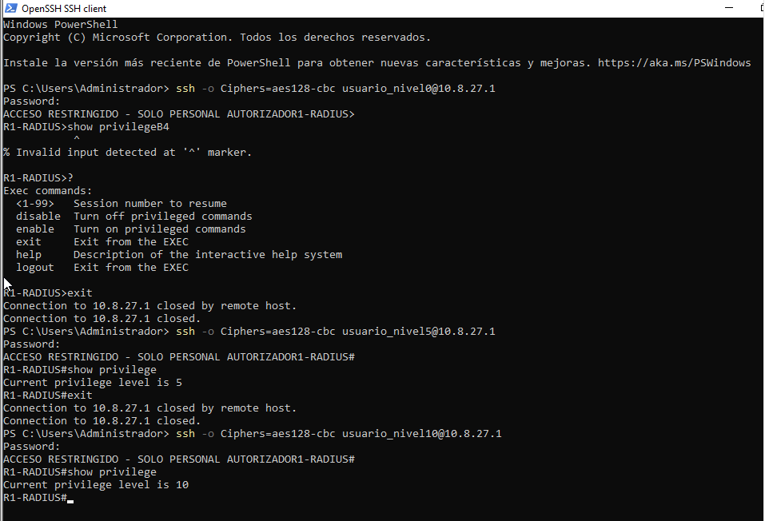

Realizamos conexiones SSH hacia `10.8.27.1` con los usuarios de niveles 0, 5 y 10.

Los usuarios de nivel 5 y 10 pudieron comprobar sus privilegios mediante `show privilege`.

El usuario de nivel 0 pudo iniciar sesión, pero tenía restricciones para ejecutar comandos administrativos.

### Evidencia 20 – Pruebas SSH de niveles 0, 5 y 10 en el switch

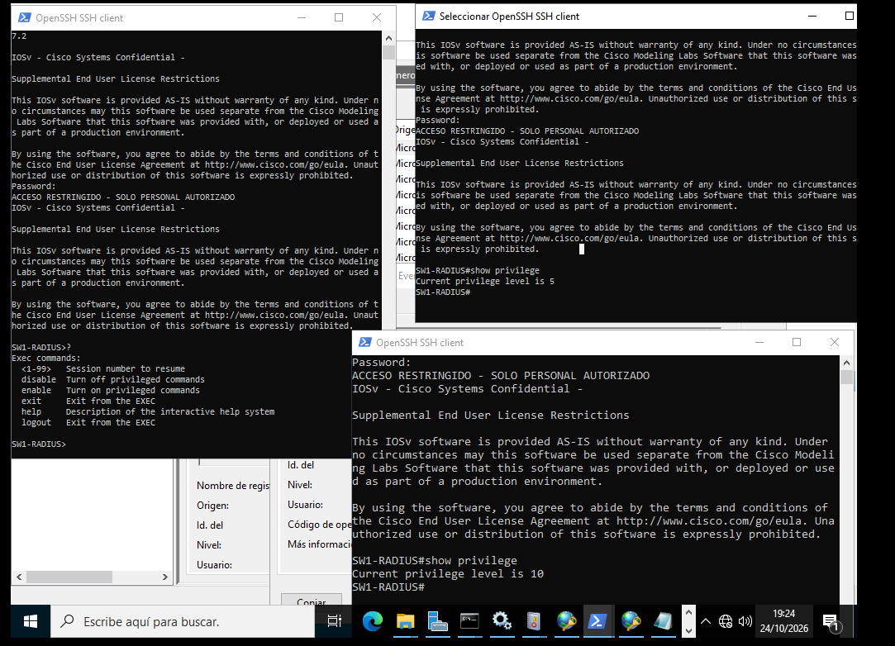

Realizamos conexiones SSH hacia `10.8.27.2` utilizando los tres usuarios.

Comprobamos que los usuarios recibían los niveles de privilegio correspondientes a sus políticas RADIUS.

### Evidencia 21 – Autenticación local del administrador

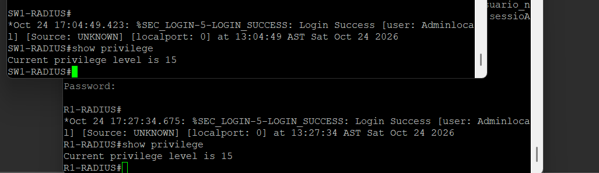

Verificamos el acceso local con el usuario `adminlocal` en el router y el switch.

En ambos dispositivos utilizamos `show privilege` y comprobamos el nivel 15.

---

## 9. Registros de NPS

### Evidencia 22 – Configuración de registros de NPS

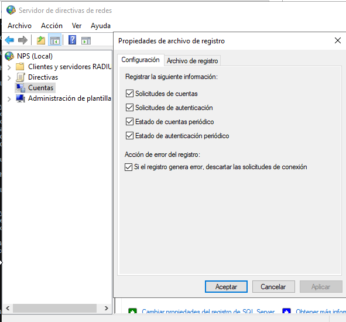

Configuramos NPS para registrar solicitudes de autenticación y Accounting.

Habilitamos las opciones:

- Solicitudes de cuentas.
- Solicitudes de autenticación.
- Estado de cuentas periódico.
- Estado de autenticación periódico.

Esto permite mantener registros de las solicitudes procesadas por el servidor.

---

## 10. Medidas de seguridad implementadas

Durante la práctica aplicamos varias medidas de seguridad:

1. Autenticación centralizada mediante RADIUS.
2. Administración de usuarios y grupos mediante Active Directory.
3. Autorización mediante niveles de privilegio 0, 5 y 10.
4. Usuario administrador local con nivel 15.
5. Acceso remoto únicamente mediante SSH.
6. Deshabilitación de los 14 puertos no utilizados del switch.
7. Registro de intentos de acceso exitosos y fallidos.
8. Accounting de sesiones remotas.
9. Deshabilitación de los servicios HTTP y HTTPS del switch.

Estas medidas ayudan a controlar el acceso a los dispositivos y mejorar la seguridad de la infraestructura.

---

## 11. Scripts y comandos utilizados

En esta sección se muestran las configuraciones principales utilizadas durante el laboratorio.

Las contraseñas y claves compartidas no se incluyen por seguridad.

### 11.1. Configuración principal del router

```cisco
hostname R1-RADIUS

interface FastEthernet0/0
 ip address 10.8.27.1 255.255.255.0
 no shutdown

aaa new-model
aaa authentication login CONSOLE_LOCAL local
aaa authentication login PRUEBA_RADIUS group radius local
aaa authorization console
aaa authorization exec CONSOLE_AUTH local
aaa authorization exec RADIUS_AUTH group radius local
aaa accounting exec REGISTRO_RADIUS start-stop group radius

radius-server host 10.8.27.10 auth-port 1812 acct-port 1813

ip ssh version 2

line con 0
 authorization exec CONSOLE_AUTH
 login authentication CONSOLE_LOCAL

line aux 0
 authorization exec CONSOLE_AUTH
 login authentication CONSOLE_LOCAL

line vty 0 4
 authorization exec RADIUS_AUTH
 accounting exec REGISTRO_RADIUS
 login authentication PRUEBA_RADIUS
 transport input ssh
```

### 11.2. Configuración principal del switch

```cisco
hostname SW1-RADIUS

interface Vlan1
 ip address 10.8.27.2 255.255.255.0
 no shutdown

ip default-gateway 10.8.27.1

aaa new-model
aaa authentication login CONSOLE_LOCAL local
aaa authentication login PRUEBA_RADIUS group radius local
aaa authorization console
aaa authorization exec CONSOLE_AUTH local
aaa authorization exec RADIUS_AUTH group radius local
aaa accounting exec REGISTRO_RADIUS start-stop group radius

radius server NPS-SERVER
 address ipv4 10.8.27.10 auth-port 1812 acct-port 1813

ip ssh version 2

line con 0
 authorization exec CONSOLE_AUTH
 login authentication CONSOLE_LOCAL

line aux 0
 authorization exec CONSOLE_AUTH
 login authentication CONSOLE_LOCAL

line vty 0 4
 authorization exec RADIUS_AUTH
 accounting exec REGISTRO_RADIUS
 login authentication PRUEBA_RADIUS
 transport input ssh

no ip http server
no ip http secure-server
```

### 11.3. Comandos de verificación

```cisco
show ip interface brief
show ip ssh
show radius statistics
show aaa servers
show interfaces status
show logging | include LOGIN
show privilege
show running-config
```

### 11.4. Pruebas SSH desde PowerShell

```powershell
# Router
ssh -o Ciphers=aes128-cbc usuario_nivel0@10.8.27.1
ssh -o Ciphers=aes128-cbc usuario_nivel5@10.8.27.1
ssh -o Ciphers=aes128-cbc usuario_nivel10@10.8.27.1

# Switch
ssh -o Ciphers=aes128-cbc usuario_nivel0@10.8.27.2
ssh -o Ciphers=aes128-cbc usuario_nivel5@10.8.27.2
ssh -o Ciphers=aes128-cbc usuario_nivel10@10.8.27.2
```

La opción `aes128-cbc` se utilizó por compatibilidad con el IOS del laboratorio. En una red de producción se deben utilizar algoritmos criptográficos modernos.

---

## 12. Running-Configs

En esta carpeta se encuentran las configuraciones completas del router y del switch utilizadas durante el laboratorio.

- [Running-Config del router R1-RADIUS](Configuraciones/Show%20running%20R1-RADIUS.txt)
- [Running-Config del switch SW1-RADIUS](Configuraciones/Show%20running%20SW-RADIUS.txt)

Las configuraciones incluyen AAA, RADIUS, SSH, Accounting y las medidas de seguridad implementadas.

Por seguridad, se han ocultado las contraseñas y claves compartidas.


---

## 13. Resultados del laboratorio

Al finalizar el laboratorio conseguimos implementar una infraestructura donde el router y el switch utilizan Windows Server 2022 como servidor de autenticación centralizada.

Creamos los usuarios y grupos en Active Directory, configuramos las políticas RADIUS en NPS y asignamos niveles de privilegio diferentes.

También comprobamos las conexiones SSH, los registros de autenticación, Accounting y el acceso local del administrador.

En el switch aplicamos medidas adicionales de seguridad deshabilitando los puertos que no se utilizaban.

Las evidencias incluidas en este repositorio muestran las configuraciones realizadas y los resultados de las pruebas.

---

## 14. Conclusión

Con esta práctica aprendi cómo implementar autenticación centralizada mediante RADIUS, AAA y Windows Server 2022 para controlar el acceso a dispositivos Cisco.

Comprendi que no todos los usuarios necesitan tener los mismos permisos y que podemos administrar esos accesos mediante grupos y políticas.

También aprendi la importancia de utilizar SSH, mantener registros de las conexiones y deshabilitar los puertos que no se utilizan.

Este laboratorio me permitió poner en práctica diferentes medidas de seguridad que pueden aplicarse para proteger la administración de una infraestructura de red.

---

